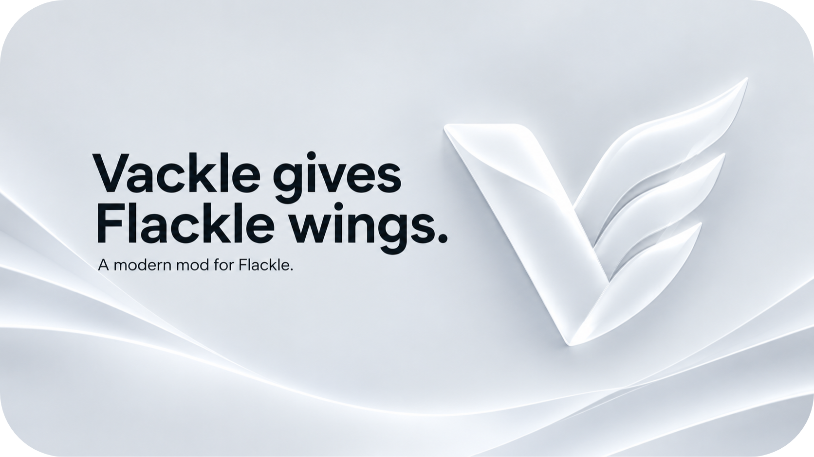

**A lightweight client mod for Flackle with 50+ plugins, custom themes and one-click install.**

[**Download**](https://vackle.dev/download) &nbsp;&nbsp;·&nbsp;&nbsp; [**Join the Community**](https://flackle.com/invite/7VW8IXBE) &nbsp;&nbsp;·&nbsp;&nbsp; [**Releases**](https://github.com/sinincali/vackle/releases/latest)

## Features

### Easy to install

One `Vackle.exe` finds Flackle and sets everything up.

### 50+ built in plugins

Fairly lightweight despite how many there are. Browse the full list and see what each one does at [vackle.dev/plugins](https://vackle.dev/plugins).

### Custom CSS and themes

Inbuilt CSS editor with support to import any CSS file. You can also find community made themes at [vackle.dev/themes](https://vackle.dev/themes) and install them in a few clicks.

### Optional encrypted Cloud Sync

Keep your plugin settings, themes and QuickCSS in sync between devices. It's off until you turn it on, needs no account, and everything is encrypted on your device with a recovery key that only you hold. Available in the desktop app.

## Installing / Uninstalling

Download `Vackle.exe` from [vackle.dev](https://vackle.dev/download) and run it. It also updates, repairs and uninstalls Vackle

### Browser extension (flackle.com in Chrome, Edge, Brave or Firefox)

Download `extension.zip` from the [latest release](https://github.com/sinincali/vackle/releases/latest) and unzip it. Open `chrome://extensions` (`brave://extensions` in Brave), turn on Developer mode, click Load unpacked and pick the unzipped folder. To remove it, remove the extension.

### Userscript (flackle.com with Tampermonkey or Violentmonkey)

Install [Tampermonkey](https://www.tampermonkey.net) or [Violentmonkey](https://violentmonkey.github.io), then open [Vackle.user.js](https://github.com/sinincali/vackle/releases/download/devbuild/Vackle.user.js) and click Install. It updates itself. In Chrome and Edge, turn on "Allow User Scripts" in the userscript manager's extension details. In Firefox, use Tampermonkey. Use either the extension or the userscript, not both.

The userscript can't block ads in YouTube embeds, and its settings are separate from the extension's.

---

<a href="https://star-history.com/#sinincali/vackle&Timeline">
  <picture>
    <source media="(prefers-color-scheme: dark)" srcset="https://api.star-history.com/svg?repos=sinincali/vackle&type=Timeline&theme=dark" />
    <source media="(prefers-color-scheme: light)" srcset="https://api.star-history.com/svg?repos=sinincali/vackle&type=Timeline" />
    
  </picture>
</a>

 

Vackle is an unofficial, independent project. It isn't made or endorsed by Flackle or Folkward LLC. Flackle is their trademark.

